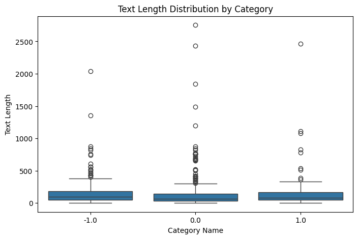
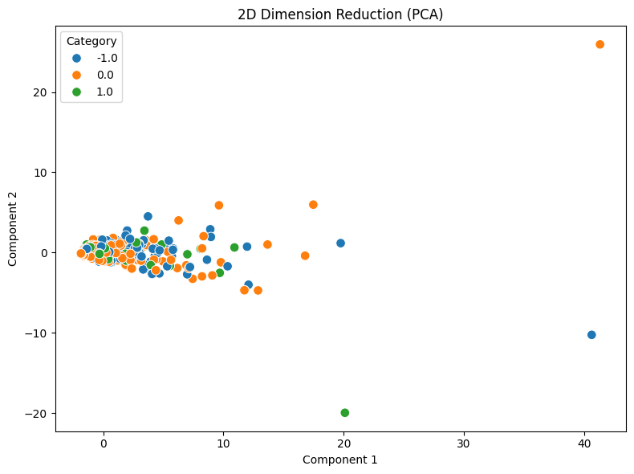
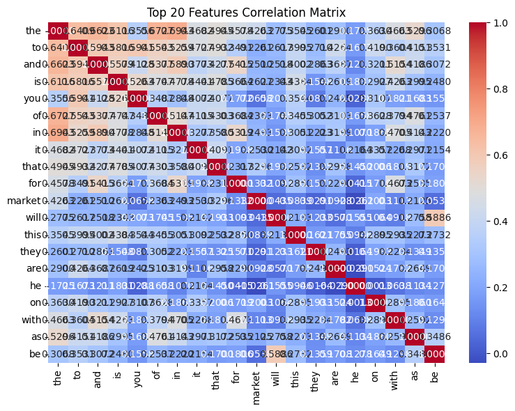
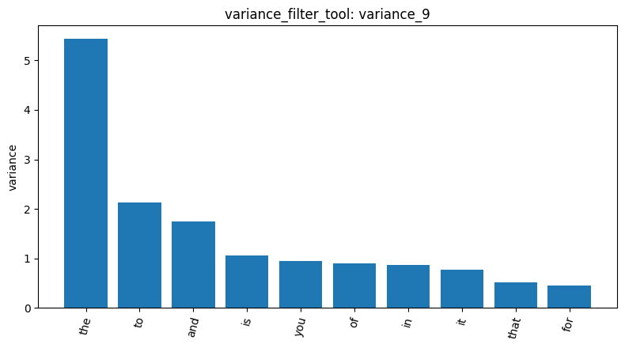

# Homework Report: Reddit Stock Sentiment

I loaded the Reddit stock-sentiment dataset in `load_dataset_1`. It contains 847 comments: 315 labeled negative (`-1.0`), 423 neutral (`0.0`), and 109 positive (`1.0`). `inspect_data_2` confirmed the normalized columns are `text`, `category_name`, and `category`; `check_missing_3` found no missing values. `check_duplicates_4` reported 23 extra duplicate copies, and I used `drop=False`, so the working dataset remained at 847 rows. In `describe_data_5`, text length averaged 148.68 characters (median 79; range 1–2,753). The category box plot is below.

`tokenize_6` reported 26,386 tokens and 4,534 unique tokens. I built the unigram DTM in `dtm_7` with `min_df=1` and proportional `max_df=1.0`; it has 847 documents, 4,346 terms, and 17,193 nonzero entries out of 3,681,062 cells (99.53% sparsity). In `term_freq_8`, the most frequent terms were common words such as “the” (920), “to” (566), and “and” (488). The `dtm_heatmap_20` slice of the first five documents and first ten vocabulary terms contains only zeros, showing that this positional slice consists of terms absent from those documents; it does not describe the rest of the DTM.

The filters show how different criteria narrow the vocabulary: `variance_9` kept 506 of 4,346 terms at threshold 0.01, while `pearson_10` kept 26 and `spearman_11` kept 30 for the negative class at threshold 0.1. The correlation-filter response did not provide exact coefficients, so I report only the returned counts. For pattern mining, FPGrowth found no negative-class patterns at `min_sup=20` (`mine_patterns_12`); at `min_sup=5`, it found 65 negative, 1,117 neutral, and 7 positive patterns (`mine_patterns_13`, `mine_patterns_14`, and `mine_patterns_15`). Top-K returned 10 neutral patterns (`mine_patterns_21`) and 10 negative patterns (`mine_patterns_22`); these returned lists were mostly single-word patterns with supports between 7 and 9. The classes have different sizes, so their raw pattern counts are not directly comparable as rates.

PCA in `reduce_dimensions_16` produced two components explaining 0.2700 and 0.0499 of the variance, respectively (0.3199 combined), and `binarize_labels_17` created one indicator column for each of the three sentiment classes. The PCA plot shows the document projections colored by category.

For documents 0 and 1, `cosine_similarity_18` returned 0.0; their displayed texts share no terms, which is consistent with no shared DTM features. `feature_correlation_19` selected 20 terms by variance; its strongest positive pair was “the” and “in” (0.6943), while the strongest negative pair was “are” and “he” (-0.0290). The correlation heatmap and the variance-filter bar chart provide visual summaries of these results.

